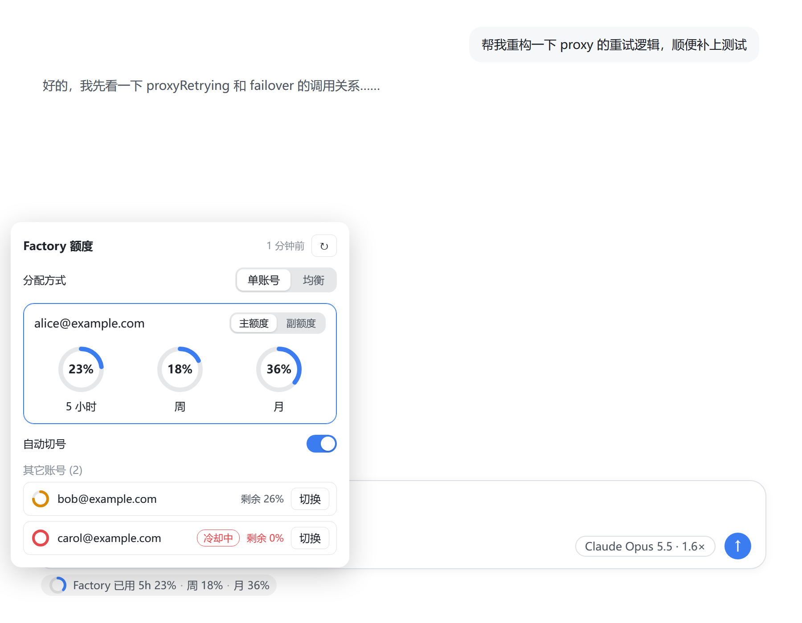
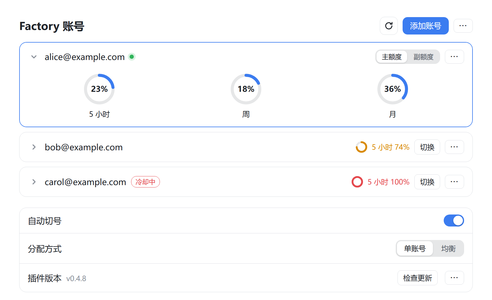
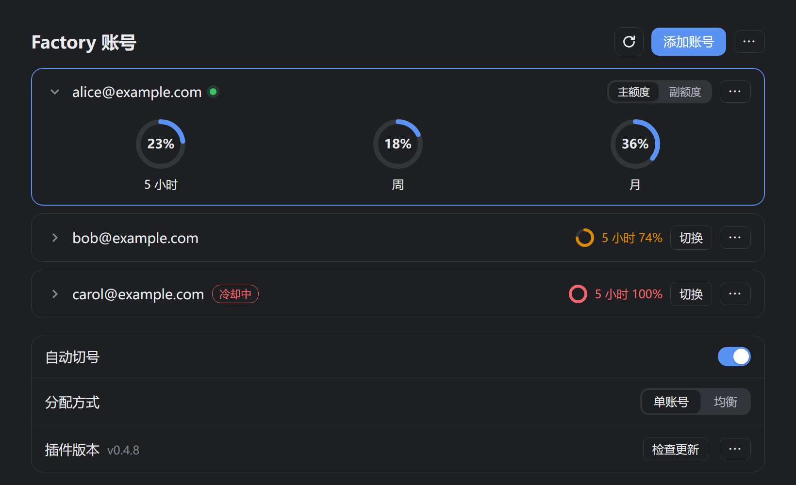
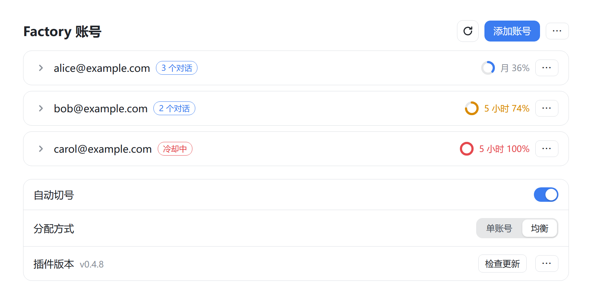
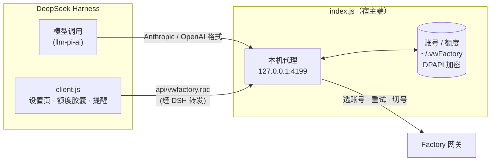

<div align="center">

# vwFactory for DeepSeek Harness

**在 DeepSeek Harness（DSH）里直接使用 Factory 账号的 50+ 模型：多账号自动切换、额度一眼看清。**

[](../../releases/latest)
[](../../releases)
[](#快速开始)
[](LICENSE)
[](CONTRIBUTING.md)

[快速开始](#快速开始) · [功能](#功能) · [工作原理](#工作原理) · [参与贡献](#参与贡献) · [English](#english)



</div>

## 功能

- **50+ 模型，一个入口**：Claude、GPT、Gemini、Grok、DeepSeek、Kimi、GLM、MiniMax……新模型由插件自动检测并加入模型列表，不用等插件更新
- **多账号**：额度用完、限流（429）或上游出错时自动切到下一个账号；也可以按对话**均衡**分配，同一对话始终留在同一账号上
- **额度随时可见**：输入框下方显示 5 小时 / 周 / 月用量，点开可以直接切号；快用完时弹窗提醒
- **稳**：断流、卡住、5xx 自动重试和借号；中文 / emoji 不乱码；停止生成会同时取消上游请求
- **安全**：API Key 只存在本机，用 Windows 账户加密（DPAPI），不经过任何第三方服务器
- **一键更新**：设置页里检查更新、更新、回滚，更新包校验 SHA-256

<table>
<tr>
<td width="50%"></td>
<td width="50%"></td>
</tr>
<tr>
<td align="center">设置页：当前账号的三个额度窗口一目了然</td>
<td align="center">跟随 DSH 的深色主题</td>
</tr>
<tr>
<td width="50%"></td>
<td>
<b>均衡模式</b>：新对话分配给额度剩得多、手上对话少的账号，之后一直留在这个账号上；每个账号显示正在服务的对话数，限流中的账号标为「冷却中」，冷却结束自动恢复。
</td>
</tr>
</table>

### 支持的模型

| 系列 | 例子 | DSH 里的分组 |
|---|---|---|
| Claude | Opus 5.5 / Sonnet 5 / Haiku 4.5 … | Factory (Claude) |
| GPT | GPT-6 Sol / GPT-5.5 / GPT-5.3 Codex … | Factory (GPT) |
| Grok | Grok 4.7 / 4.6 / 4.5 | Factory (GPT) |
| Gemini | Gemini 3.1 Pro / 3.8 Flash … | Factory |
| 开源模型 | DeepSeek V4 / Kimi K3 / GLM 5.3 / MiniMax M3 / Nemotron … | Factory |

具体可用哪些，以你的账号为准：插件会逐个探测，只把能用的写进模型列表，名字后面带计费倍率（如 `Claude Opus 5.5 · 1.6×`）。

## 快速开始

**一、安装插件**

1. 下载 DeepSeek Harness 并**启动一次**（一定要启动一次，否则 DSH 配置文件夹还没创建）
2. 到 [Releases](../../releases/latest) 下载 `vwfactory-dsh-vX.Y.Z.zip` 并解压
3. 双击 `install.bat`（DSH 正在运行时会询问是否自动重启，直接回车）

**二、添加 Factory 的 API Key**

1. Factory 官网 → Settings → API Keys → Create Key，名字随便起，日期不用选
2. 复制 Key，打开 DSH → 设置 → Factory 账号 → 添加账号，按 `邮箱----Key` 填入（邮箱只用来区分账号；每行一个，可以一次加多个）
   - 也可以在 DSH 运行时用浏览器打开 http://127.0.0.1:4199/ 导入

**三、开始用**

在输入框右侧的模型选择里，选 Factory (Claude) / Factory (GPT) / Factory (Grok) / Factory 下的模型。

- **更新**：DSH 设置 → Factory 账号 → 插件版本 → 点「更新」，然后重启 DSH（也可以下载新压缩包重新运行 `install.bat`，账号保留）
- **卸载**：双击 `uninstall.bat`（加 `-RemoveData` 连账号数据一起删）

更多说明见 [README.txt](README.txt)，更新记录见 [CHANGELOG.txt](CHANGELOG.txt)。

## 工作原理

插件分两半：宿主端在本机起一个代理，界面端往 DSH 里加设置页和额度胶囊。DSH 把 Factory 当成普通的模型提供方，请求发到本机代理，由代理选账号、补请求头、转发到 Factory 网关。



| 模型 | DSH 用的格式 | Factory 网关路由 | `x-api-provider` |
|---|---|---|---|
| Claude | Anthropic Messages | `/api/llm/a/v1/messages` | `anthropic` |
| GPT | OpenAI Responses | `/api/llm/o/v1/responses` | `openai` |
| Grok | OpenAI Responses | `/api/llm/o/v1/responses` | `xai` |
| Gemini | OpenAI Chat | `/api/llm/o/v1/chat/completions` | `google` |
| 开源模型 | OpenAI Chat | `/api/llm/o/v1/chat/completions` | `fireworks` |

## 参与贡献

欢迎提 Issue 和 PR！项目**没有构建步骤**，改完 `plugin/` 下的 JS 就能直接装进 DSH 试，上手很快。

```text
plugin/index.js          宿主端：本机代理、账号 / 额度 / 切号、模型探测、在线更新
plugin/client.js         界面端（React）：设置页、额度胶囊、侧栏、提醒，中英文案也在这里
templates/llm-pi-ai.yml  安装时写入 DSH 的模型提供方配置
tests/                   回归测试：模拟上游测代理，检查中英文案
tools/preview/           不装 DSH 也能预览界面（README 截图也由它生成）
install.ps1 / pack.ps1   安装脚本 / 打包脚本
```

**开发流程**

1. 改代码，然后在仓库根目录运行 `install.bat`，把当前代码装进 DSH
   - 只改了 `client.js`：在 DSH 里按 `Ctrl+R` 刷新即可
   - 改了 `index.js`：需要完全退出并重启 DSH
2. 只改界面时可以不装 DSH：用浏览器打开 `tools/preview/gallery.html?shot=settings`（还有 `settings-dark` / `balance` / `pill`，加 `-en` 看英文）
3. 跑测试（Node 18+）：`node tests/proxy.test.mjs` 和 `node tests/i18n.test.mjs`

详细的约定（文件编码、测试、PR 清单）见 [CONTRIBUTING.md](CONTRIBUTING.md)。

**可以从这些开始**

- 给 Grok 单独一个「Factory (Grok)」分组，现在和 GPT 放在一起
- Gemini 改走原生路由 `/api/llm/g/v1/generate`，不再依赖 OpenAI 兼容格式
- 安装 / 卸载脚本支持 macOS、Linux（插件本身是跨平台的，只有 DPAPI 加密和 `.ps1` 脚本是 Windows 专用）
- 额度提醒弹窗加进 `tools/preview`，方便截图和调样式
- 英文版 README

## 说明

本项目与 Factory.ai 官方无关，使用自己的账号需遵守 Factory 的服务条款。[MIT License](LICENSE)。

## English

**vwFactory** is a DeepSeek Harness plugin that lets you use the models on your Factory account — Claude, GPT, Gemini, Grok, DeepSeek, Kimi, GLM, MiniMax and more — directly inside DSH. It runs a local proxy on `127.0.0.1:4199` that picks an account, retries transient failures, switches accounts on quota exhaustion or rate limits, and shows live quota under the composer. API keys stay on your machine, encrypted with Windows DPAPI.

Install: download the latest zip from [Releases](../../releases/latest), unzip, and run `install.bat`. Contributions are welcome — there is no build step; see [CONTRIBUTING.md](CONTRIBUTING.md).
